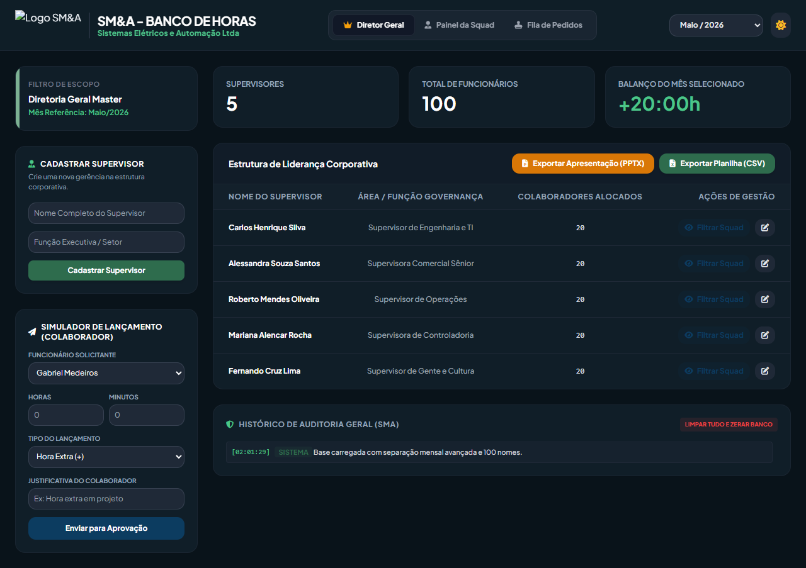

# Arthur Monserrat Portfolio

> **Status:** publicado na Vercel; envio por e-mail aguarda configuração e teste real no EmailJS.

Portfólio profissional de Arthur Monserrat Souza, estudante de Engenharia de Software. É uma entrega do LAB01 de DIAW, estruturada como página única acessível para apresentar projetos públicos, experiências técnicas e contato.

## Links

- Site publicado: [arthur-monserrat-portfolio.vercel.app](https://arthur-monserrat-portfolio.vercel.app).
- Código-fonte: [ArthurMonserrat/arthur-monserrat-portfolio](https://github.com/ArthurMonserrat/arthur-monserrat-portfolio).
- Wireframes: [Figma](https://www.figma.com/design/AP1vCzHXem9UYPc8woX1aO).
- Repositórios apresentados: [Sistema de Apontamento de Horas](https://github.com/ArthurMonserrat/sma-apontamento-horas) e [Banco de Horas 2](https://github.com/ArthurMonserrat/banco-de-horas-2).

## Funcionalidades

- Navegação de uma página por âncoras.
- Apresentação alternável entre português e inglês.
- Timeline cronológica de projetos e experiências com dados locais.
- Links para repositórios e aplicações públicas.
- Formulário com validação de nome, e-mail e mensagem, estado de envio e feedback acessível.
- Layout responsivo, HTML semântico, labels, foco visível e contraste alto.
- Capturas reais dos dois projetos em seus cards e em `docs/screenshots/`.

## Tecnologias e arquitetura

- React 19, Vite, JavaScript e CSS puro.
- Vitest + Testing Library para testes de interface.
- `@emailjs/browser` para envio direto no cliente.
- Vercel para hospedar o front-end estático.

O navegador entrega o front-end React pela Vercel. Quando configurado, o formulário chama o EmailJS diretamente. Não há API própria, banco de dados ou autenticação neste projeto.

## Estrutura

```text
src/
  components/       # Header, About, Timeline, Contact, Footer
  data/             # projetos e experiências em arrays
  test/             # setup do Vitest
docs/
  wireframes/       # exportações desktop e mobile do Figma
  screenshots/      # capturas reais dos projetos apresentados
.env.example        # nomes das variáveis públicas do EmailJS
```

## Executar localmente

Pré-requisito: Node.js LTS.

```bash
npm install
npm run dev
npm test
npm run build
```

## Configurar EmailJS

1. Copie `.env.example` para `.env.local`.
2. Preencha os três identificadores públicos da conta EmailJS.
3. Reinicie `npm run dev`.
4. Faça um envio real de teste antes de afirmar que o formulário está funcional.

As chaves não devem ser enviadas ao Git. Para a Vercel, configure as mesmas variáveis no painel do projeto.

## Deploy

1. Suba este repositório no GitHub.
2. Importe-o na Vercel e mantenha o preset Vite.
3. Configure as variáveis do EmailJS, se o formulário for ativado.
4. Execute/verifique o build e publique.

## Wireframes

Os wireframes de média fidelidade da Sprint 01 foram criados no Figma e exportados para o repositório.


## Capturas dos projetos

As evidências foram registradas a partir das aplicações/código público dos próprios projetos em 15 de outubro de 2026.




## Verificações realizadas

- `npm test`: valida a navegação, a alternância de idioma, as capturas dos projetos e a validação de formulário.
- `npm run build`: gera o bundle de produção Vite.
- Wireframes desktop e mobile revisados visualmente no Figma.
- URL de produção aberta em navegador e verificada, inclusive sem autenticação.

## Evidências pendentes

- Contatos pessoais adicionais (e-mail público, LinkedIn e WhatsApp), se desejados.
- Credenciais e teste real do EmailJS.

## Referências

- [Template de README do professor](https://github.com/joaopauloaramuni/desenvolvimento-e-integracao-de-aplicacoes-web/blob/main/TEMPLATES/template_README.md).
- Portfólios de [Flávio Júnior](https://flaviojunior-portfolio.vercel.app/), [Gabriel Victor](https://gabrielvictor.web.app/), [Pedro Braga](https://www.pedrobragadev.com/) e [Luca Azalim](https://azal.im/), consultados como inspiração de organização e apresentação.

## Autor

Arthur Monserrat Souza.
