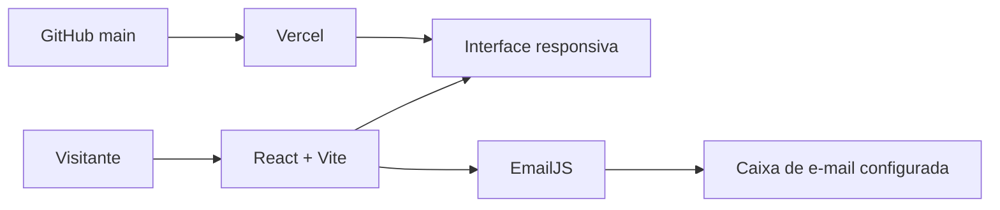
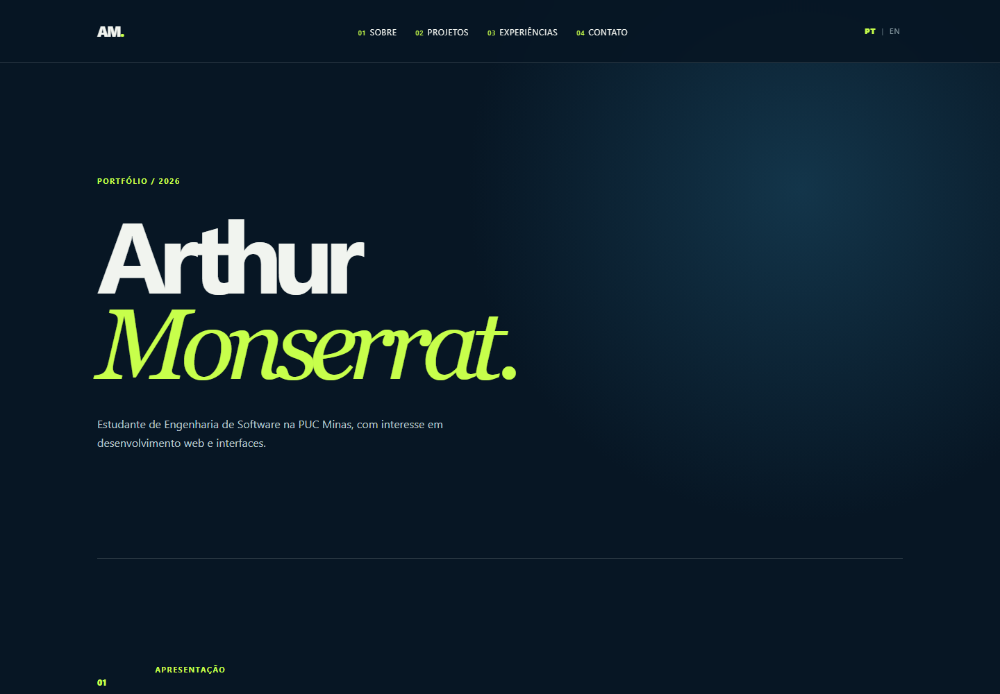
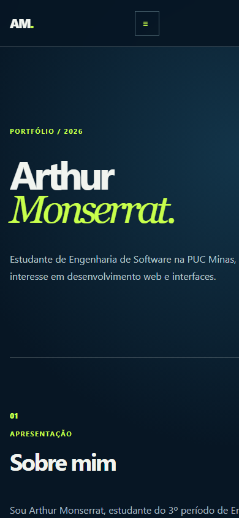

# LAB01 - Portfólio Profissional | Arthur Monserrat

<p align="center">
  
</p>

<p align="center">Portfólio profissional responsivo desenvolvido para a disciplina Desenvolvimento e Integração de Aplicações Web (DIAW), da Engenharia de Software da PUC Minas.</p>


**Status:** concluído, publicado e sincronizado com `main`.

## Índice

- [Links úteis](#links-úteis)
- [Sobre o projeto](#sobre-o-projeto)
- [Funcionalidades principais](#funcionalidades-principais)
- [Tecnologias e dependências](#tecnologias-e-dependências)
- [Arquitetura](#arquitetura)
- [Instalação e execução](#instalação-e-execução)
- [Variáveis de ambiente](#variáveis-de-ambiente)
- [Deploy na Vercel](#deploy-na-vercel)
- [Estrutura de pastas](#estrutura-de-pastas)
- [Demonstração](#demonstração)
- [Testes](#testes)
- [Matriz de requisitos do LAB01](#matriz-de-requisitos-do-lab01)
- [Documentações e referências](#documentações-e-referências)
- [Autor](#autor)
- [Agradecimentos](#agradecimentos)

## Links úteis

- **Site publicado:** [arthur-monserrat-portfolio.vercel.app](https://arthur-monserrat-portfolio.vercel.app/)
- **Repositório:** [github.com/ArthurMonserrat/arthur-monserrat-portfolio](https://github.com/ArthurMonserrat/arthur-monserrat-portfolio)
- **Figma:** [wireframes do portfólio](https://www.figma.com/design/AP1vCzHXem9UYPc8woX1aO)
- **LinkedIn:** [linkedin.com/in/arthurmonserrat](https://www.linkedin.com/in/arthurmonserrat)

## Sobre o projeto

O LAB01 - Portfólio Profissional apresenta a formação, os interesses, a experiência e os canais de contato de Arthur Monserrat Souza. O projeto foi desenvolvido para a disciplina DIAW, sob orientação do professor João Paulo Carneiro Aramuni, como uma página única responsiva com navegação por seções.

O portfólio inclui um estudo de caso do Sistema de Apontamento de Horas da SM&A. Esse sistema empresarial é apresentado somente com informações e uma captura autorizada da tela de entrada. Código-fonte, rotas, dados internos e link de acesso empresarial não são publicados por confidencialidade.

## Funcionalidades principais

- Apresentação profissional em português e inglês.
- Seletor global PT|EN, sem recarregar a página, com persistência no `localStorage` e atualização do atributo `lang`.
- Cabeçalho fixo, âncoras, seção ativa e menu responsivo com as quatro seções.
- Timeline com o estudo de caso do Sistema de Apontamento de Horas e experiência como estagiário na SM&A desde 2026.
- Contatos clicáveis para GitHub, LinkedIn, composição do Gmail e WhatsApp, com alternativa de e-mail direto via `mailto:`.
- Formulário de contato com nome, e-mail e mensagem, integrado ao EmailJS.
- Validações locais e mensagens de envio, sucesso e falha traduzidas.
- Favicon SVG com o monograma `AM.`.
- Layout responsivo, foco visível, HTML semântico e contraste coerente com a identidade azul-noturno e verde-lima.

## Tecnologias e dependências

### Aplicação do portfólio

| Categoria | Tecnologia | Versão declarada |
| --- | --- | --- |
| Interface | React | `^19.0.0` |
| Renderização | React DOM | `^19.0.0` |
| Linguagem | JavaScript (ES modules) | conforme Node.js LTS |
| Estilos | CSS puro | - |
| Build e desenvolvimento | Vite | `^6.2.0` |
| Testes | Vitest | `^3.0.7` |
| Testes de interface | Testing Library, jest-dom, jsdom | `^16.2.0`, `^6.6.3`, `^26.0.0` |
| Formulário | `@emailjs/browser` | `^4.4.1` |
| Hospedagem | Vercel | produção |
| Versionamento | Git e GitHub | repositório público |

As tecnologias React, TypeScript, Vite e Supabase exibidas no card do SM&A descrevem o projeto empresarial documentado, não a implementação deste portfólio. A lista de conhecimentos pessoais publicada na seção Sobre mim contém somente tecnologias com evidência de uso ou estudo no material disponível.

## Arquitetura

O projeto é um front-end estático React/Vite. O navegador renderiza os componentes locais e, quando configurado, envia o formulário diretamente ao EmailJS. O GitHub mantém o código e a Vercel gera e publica o bundle do Vite. Não há API própria, banco de dados ou autenticação neste repositório.



## Instalação e execução

### Pré-requisitos

- Node.js LTS e npm.
- Uma conta EmailJS configurada somente se o formulário precisar enviar mensagens em ambiente local.

### Executar localmente

```bash
git clone https://github.com/ArthurMonserrat/arthur-monserrat-portfolio.git
cd arthur-monserrat-portfolio
npm install
npm run dev
```

O Vite informa no terminal a URL local, normalmente `http://localhost:5173`.

### Testar e gerar build

```bash
npm test -- --run
npm run build
```

## Variáveis de ambiente

Copie `.env.example` para `.env.local` e preencha os identificadores públicos da sua própria conta EmailJS:

```dotenv
VITE_EMAILJS_SERVICE_ID=seu_service_id
VITE_EMAILJS_TEMPLATE_ID=seu_template_id
VITE_EMAILJS_PUBLIC_KEY=sua_public_key
```

Os valores reais não são versionados. Sem as três variáveis, o formulário preserva a validação, mas informa que o envio não está disponível. O template EmailJS utilizado pelo projeto recebe `name`, `email` e `message`, com `email` em Reply-To.

## Deploy na Vercel

1. Importe o repositório GitHub na Vercel.
2. Mantenha o preset Vite e o comando de build `npm run build`.
3. Configure as três variáveis `VITE_EMAILJS_*` no ambiente Production.
4. Faça o deploy ou redeploy após qualquer alteração de variável.
5. Confira a URL pública: [arthur-monserrat-portfolio.vercel.app](https://arthur-monserrat-portfolio.vercel.app/).

## Estrutura de pastas

```text
.
├── public/
│   ├── favicon.svg
│   └── images/projects/          # imagem real do estudo de caso SM&A
├── docs/
│   ├── screenshots/              # capturas do portfólio e do estudo de caso
│   ├── superpowers/              # especificação e plano da implementação
│   └── wireframes/               # exportações desktop/mobile do Figma
├── src/
│   ├── components/               # Header, About, Timeline, Contact e Footer
│   ├── data/                     # dados do projeto e da experiência
│   ├── hooks/                    # persistência e sincronização do idioma
│   ├── i18n.js                   # dicionários PT/EN
│   ├── App.jsx
│   └── App.test.jsx
├── .env.example
├── index.html
├── package.json
└── vite.config.js
```

## Demonstração

### Wireframes do Figma


### Site publicado





### Estudo de caso SM&A


A imagem acima é a captura real autorizada da tela de entrada. Não foi publicada uma tela de login do colaborador porque não havia uma imagem obtida com autorização verificável. Essa captura adicional pode ser incluída futuramente, mas não é tratada como obrigação literal do professor.

## Testes

Comandos executados na versão final:

- `npm test -- --run`: **17 testes aprovados**.
- `npm run build`: **build Vite aprovado**.
- `git diff --check`: **sem erros de whitespace**.

A suíte cobre navegação, menu mobile, alternância PT/EN, persistência do idioma, preservação dos dados do formulário, validações, estados mockados do EmailJS, projeto único, favicon, contatos Gmail/WhatsApp e fallback `mailto`.

## Matriz de requisitos do LAB01

| Requisito | Status | Evidência |
| --- | --- | --- |
| Sobre Mim em português e inglês | Atendido | Dicionários locais PT/EN, seletor global e persistência do idioma. |
| Projetos em timeline com descrição, tecnologias e imagem/GIF | Atendido | Estudo de caso SM&A com descrição, tecnologias documentadas e captura real da tela de entrada. |
| Link do repositório de cada projeto | Parcial | O projeto empresarial não possui link público por confidencialidade; o repositório do portfólio está publicado no GitHub. |
| Experiências com instituição, função, período e descrição | Atendido | Registro da SM&A como estágio, de 2026 até o período atual. |
| Contato com ícones e formulário funcional | Atendido | GitHub, LinkedIn, Gmail, WhatsApp, `mailto` alternativo e EmailJS validado anteriormente em produção. |
| Validações e responsividade | Atendido | Testes automatizados, layout desktop/mobile, menu responsivo e foco visível. |
| Deploy em nuvem | Atendido | Produção publicada na Vercel. |
| README final, wireframes e demonstrações | Atendido | Esta documentação, exportações do Figma e capturas atuais versionadas. |
| Segunda captura de login do colaborador | Pendente opcional | Não há autorização ou imagem verificável disponível; não é considerada requisito literal do LAB01. |

## Documentações e referências

- Enunciado do LAB01 e material fornecido na disciplina DIAW.
- [Template oficial de README do professor João Paulo Carneiro Aramuni](https://github.com/joaopauloaramuni/desenvolvimento-e-integracao-de-aplicacoes-web/blob/main/TEMPLATES/template_README.md).
- [React](https://react.dev/), [Vite](https://vite.dev/), [Vitest](https://vitest.dev/), [Testing Library](https://testing-library.com/), [EmailJS](https://www.emailjs.com/) e [Vercel](https://vercel.com/).
- [Figma](https://www.figma.com/design/AP1vCzHXem9UYPc8woX1aO) e portfólios indicados no enunciado como referências de organização visual.

## Autor

**Arthur Monserrat Souza** - estudante de Engenharia de Software na PUC Minas.

- [GitHub](https://github.com/ArthurMonserrat)
- [LinkedIn](https://www.linkedin.com/in/arthurmonserrat)
- [Gmail](https://mail.google.com/mail/?view=cm&fs=1&to=arthurmonserrat6%40gmail.com)

## Agradecimentos

Agradeço ao professor João Paulo Carneiro Aramuni pelas orientações da disciplina DIAW e pelas referências de documentação e prototipação do LAB01.
