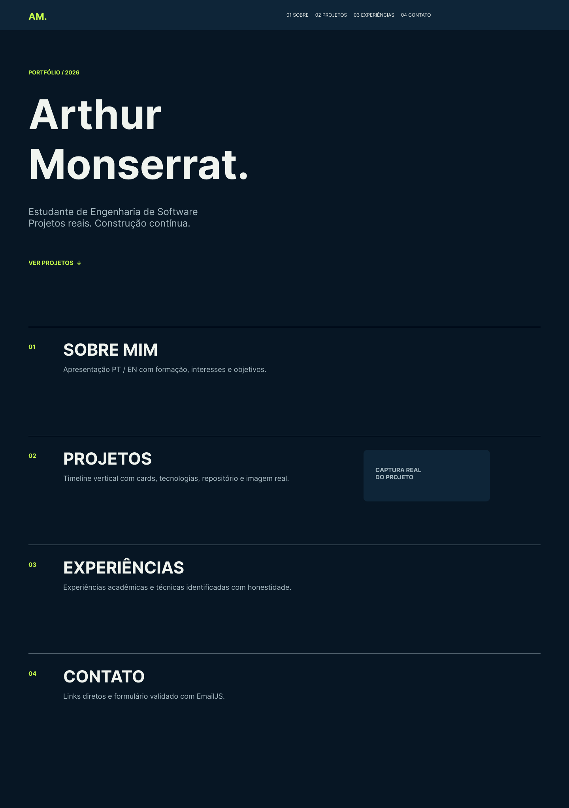
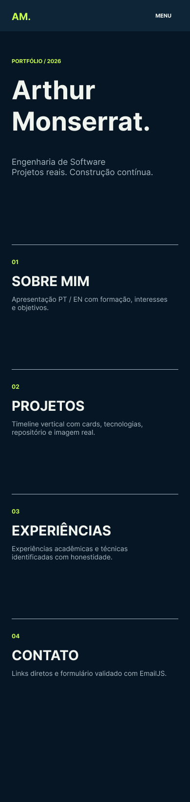
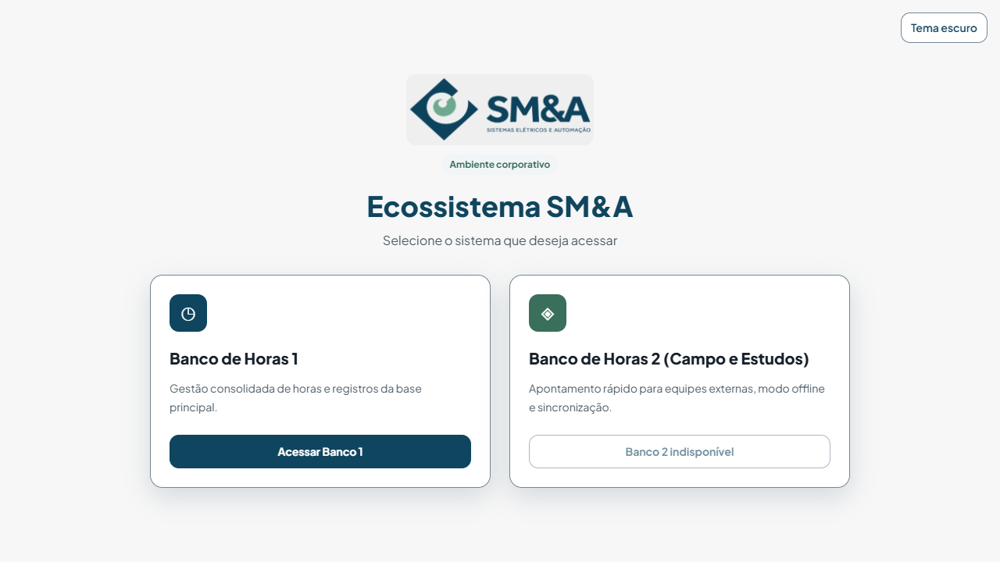

# Arthur Monserrat Portfolio

> **Status:** publicado na Vercel; formulário EmailJS configurado e validado por envio real.

Portfólio profissional de Arthur Monserrat Souza, estudante de Engenharia de Software na PUC Minas. É uma entrega do LAB01 de DIAW, estruturada como página única acessível para apresentar formação, experiência profissional, um estudo de caso selecionado e contato.

## Links

- Site publicado: [arthur-monserrat-portfolio.vercel.app](https://arthur-monserrat-portfolio.vercel.app).
- Código-fonte: [ArthurMonserrat/arthur-monserrat-portfolio](https://github.com/ArthurMonserrat/arthur-monserrat-portfolio).
- Wireframes: [Figma](https://www.figma.com/design/AP1vCzHXem9UYPc8woX1aO).

## Funcionalidades

- Cabeçalho fixo, navegação por âncoras, seção ativa e menu móvel com todas as seções.
- Apresentação alternável entre português e inglês.
- Timeline de projeto e experiência profissional com dados locais.
- Projeto corporativo apresentado sem publicar código-fonte ou rotas de acesso.
- Links diretos para GitHub, LinkedIn e e-mail público.
- Formulário EmailJS com validação de nome, e-mail e mensagem, estado de envio e feedback acessível.
- Layout responsivo, HTML semântico, labels, foco visível e contraste alto.
- Captura real da tela de entrada do Ecossistema SM&A, sem dados pessoais ou internos.

## Tecnologias e arquitetura

- React 19, Vite, JavaScript e CSS puro.
- Vitest + Testing Library para testes de interface.
- `@emailjs/browser` para envio direto no cliente.
- Vercel para hospedar o front-end estático.

O navegador entrega o front-end React pela Vercel. O formulário chama o EmailJS diretamente. Não há API própria, banco de dados ou autenticação neste projeto.

## Estrutura

```text
src/
  components/       # Header, About, Timeline, Contact, Footer
  data/             # projetos e experiências em arrays
  test/             # setup do Vitest
docs/
  wireframes/       # exportações desktop e mobile do Figma
  screenshots/      # capturas reais dos projetos apresentados
.env.example        # nomes das variáveis públicas do EmailJS
```

## Executar localmente

Pré-requisito: Node.js LTS.

```bash
npm install
npm run dev
npm test
npm run build
```

## Configurar EmailJS

1. Copie `.env.example` para `.env.local`.
2. Preencha os três identificadores públicos da conta EmailJS.
3. Reinicie `npm run dev`.
4. Na Vercel, crie as mesmas variáveis para Production e faça um novo deploy.

O serviço Gmail e o template de contato estão configurados na conta EmailJS vinculada. O template usa `{{name}}`, `{{email}}` e `{{message}}`, com `{{email}}` em Reply-To.

As chaves não devem ser enviadas ao Git. Para a Vercel, configure as mesmas variáveis no painel do projeto.

### Verificação do formulário

Em 15/10/2026, o formulário foi testado em produção. A solicitação foi registrada como `OK` no EmailJS e a mensagem chegou à caixa destinatária. Os três identificadores do EmailJS estão cadastrados somente para o ambiente Production na Vercel. Testes automatizados simulam as respostas de sucesso e de falha, mantendo mensagens genéricas para visitantes.

## Deploy

1. Suba este repositório no GitHub.
2. Importe-o na Vercel e mantenha o preset Vite.
3. Configure as variáveis do EmailJS.
4. Execute/verifique o build e publique.

## Wireframes

Os wireframes de média fidelidade da Sprint 01 foram criados no Figma e exportados para o repositório.





## Captura do projeto

O portfólio apresenta apenas o Sistema de Apontamento de Horas. A imagem abaixo é a tela de entrada real do Ecossistema SM&A, que mostra a seleção dos sistemas Banco de Horas 1 e Banco de Horas 2 (Campo e Estudos); ela não é um painel administrativo nem uma visão de colaborador e não contém dados pessoais ou internos.



## Matriz de requisitos — LAB01

| Requisito | Status | Evidência |
| --- | --- | --- |
| Sobre em português e inglês, formação, interesses e objetivo | Atendido | Seção **Sobre mim** com alternância PT/EN baseada no currículo. |
| Projetos em timeline com descrição, tecnologias e imagem/GIF | Atendido em parte | Estudo de caso SM&A com tecnologias e tela de entrada real; código e aplicação não são públicos por confidencialidade. |
| Experiências com instituição, função, período e descrição | Atendido em parte | Função, período e atividades vêm do currículo; a empresa não foi informada no currículo e não foi inventada. |
| Contato com ícones e formulário de e-mail | Atendido | Links para GitHub, LinkedIn e e-mail; envio EmailJS validado em produção. |
| Navegação, responsividade e interface | Atendido | Cabeçalho fixo, menu móvel, âncoras e foco visível. |
| Deploy, repositório e README | Atendido | Site e código públicos, instruções locais, tecnologias, dependências e estrutura documentadas. |
| Wireframes e evolução visual | Atendido | Exportações em `docs/wireframes/` e link do Figma. |

## Verificações realizadas

- `npm test`: valida navegação, alternância de idioma, projeto único, canais de contato, validação e estados de sucesso/falha do EmailJS com mock.
- `npm run build`: gera o bundle de produção Vite.
- Wireframes desktop e mobile revisados visualmente no Figma.
- URL de produção aberta em navegador e verificada, inclusive sem autenticação.
- Formulário em produção submetido com sucesso ao EmailJS.

## Limitação conhecida

A captura da visão de colaborador não estava disponível sem autenticação adicional. Ela pode substituir a tela de entrada em uma atualização futura, após revisão para remover dados internos ou pessoais.

## Referências

- [Template de README do professor](https://github.com/joaopauloaramuni/desenvolvimento-e-integracao-de-aplicacoes-web/blob/main/TEMPLATES/template_README.md).
- Portfólios de [Flávio Júnior](https://flaviojunior-portfolio.vercel.app/), [Gabriel Victor](https://gabrielvictor.web.app/), [Pedro Braga](https://www.pedrobragadev.com/) e [Luca Azalim](https://azal.im/), consultados como inspiração de organização e apresentação.

## Autor

Arthur Monserrat Souza.
